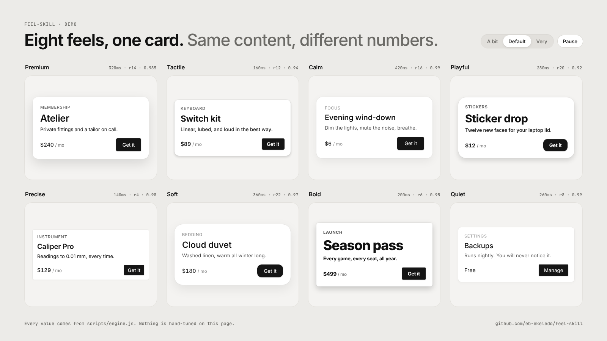
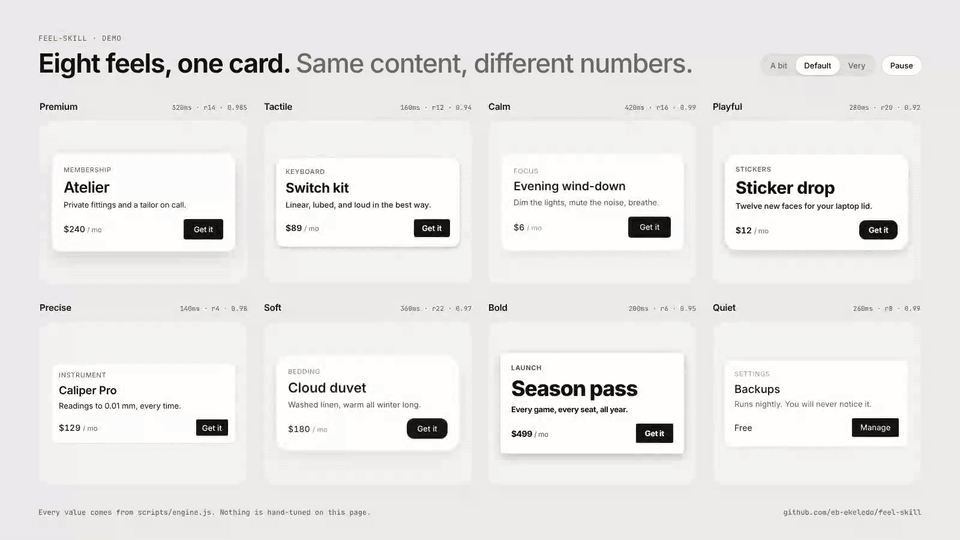

# feel-skill



**A Claude skill that turns feel words into exact design values.** Premium, tactile, calm, playful, precise, soft, bold and quiet become specific easing, springs, shadows, radius and type, so "make it feel more premium" gives you a short list of changes you can review instead of random edits.

## What you get

Say "make this card calmer and a bit more tactile". Claude maps the words to feels, runs the engine, and shows you this before touching the code:

| Property | From | To |
| --- | --- | --- |
| Transition duration | 220ms | 290ms |
| Easing curve | cubic-bezier(0.2, 0, 0, 1) | cubic-bezier(0.35, 0, 0.1, 1) |
| Press scale | 0.97 | 0.965 |
| Corner radius | 10px | 14px |
| Shadow opacity | 0.1 | 0.12 |
| Top highlight | 0 | 0.27 |
| Font weight | 500 | 550 |
| … | | |

Then it applies the same numbers as CSS custom properties, Tailwind values or a Motion spring, whichever your code uses.

- **8 feels, 15 values each**, across motion, press, depth, shape, type and density.
- **Blends.** `calm + tactile` lands between the two.
- **Intensity.** "a bit", default or "very".
- **Deterministic.** The numbers come from a small engine, not from the model's imagination. Same words, same values, every time.
- **Safe.** Every value stays inside bounds: durations 120 to 600 ms, shadows 4% to 24%, text contrast always WCAG AA.

## Install

**Claude Code**

```bash
git clone https://github.com/eb-ekeledo/feel-skill ~/.claude/skills/feel
```

**claude.ai:** download this repo as a zip and upload it as a custom skill in Claude's settings. The engine needs code execution turned on.

Requires Node 18+ to run the engine. No packages to install.

## Use

```
make this pricing card feel more premium
the toggle feels flat, make it a bit more tactile
calm down this onboarding, it's too jumpy
```

Or run the engine yourself:

```bash
node scripts/feel.js "calm + tactile" --intensity 2
node scripts/feel.js premium --intensity 3 --format css
node scripts/feel.js playful --format motion
```

See [`examples/`](examples) for three before and after edits (plain CSS, Tailwind, Motion).

## Demo



Open [`demo/index.html`](demo/index.html) in a browser. It shows one card in all eight feels, with an intensity switch. Every value on the page comes from the engine.

## How it works

```
"make it calmer"  →  word map (SKILL.md)  →  feel: calm, intensity 2
                  →  scripts/engine.js    →  15 values, blended and clamped
                  →  change table + CSS / Tailwind / Motion edit
```

Each feel's character, signature moves, do and don't live in [`references/feels/`](references/feels). The numbers live in one place, [`scripts/engine.js`](scripts/engine.js).

## Quality

```bash
node scripts/check.js
```

The checks cover every feel and every two-feel blend at three intensities: value bounds, grid rounding, AA contrast, no overshoot except playful, the same output on repeated runs, and examples that match the engine. See [`evals/`](evals) for trigger tests and the blind comparison plan.

## Part of a set

Tools for designers who build in Claude:

- **feel-skill:** feel words to values (this repo)
- [**state-sheet-skill**](https://github.com/eb-ekeledo/state-sheet-skill): every state of a component on one review sheet
- [**taste-lint**](https://github.com/eb-ekeledo/taste-lint): grades your UI against your DESIGN.md

Made by [Ebere](https://ebere.design). MIT licensed.
